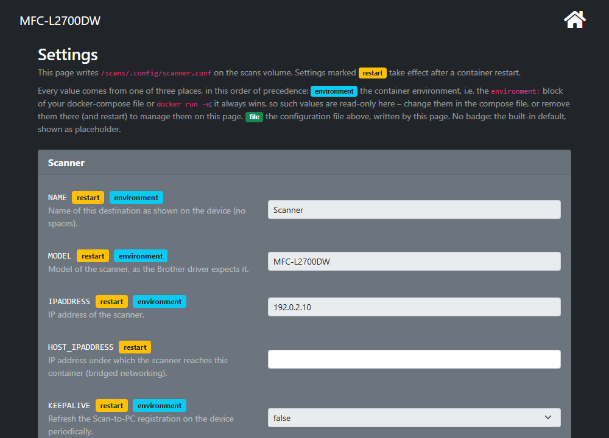
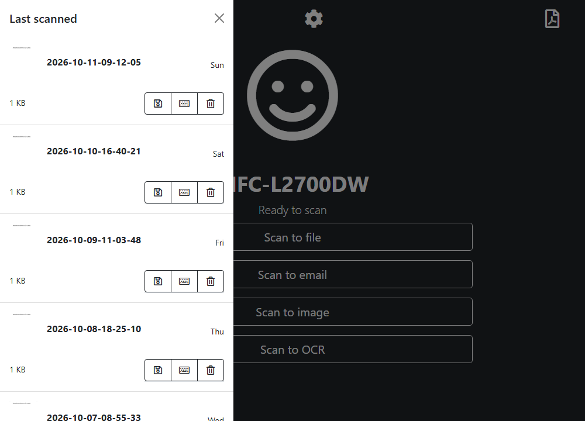
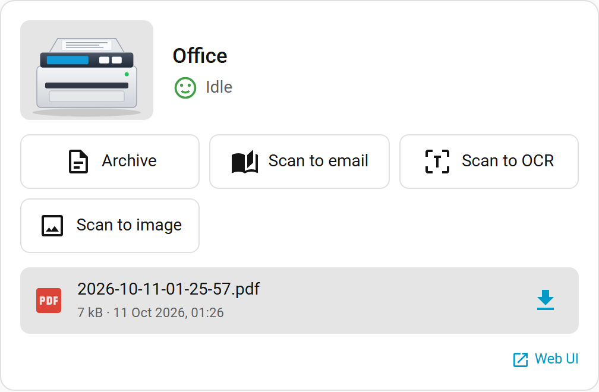

# Dockerized Brother Scanner

This is a dockerized scanner setup for Brother scanners.
It allows you to run your scan server in a Docker environment and thus also on devices such as a Synology DiskStation.
Additionally, some scripts are included that allow you to easily create duplex documents on non-duplex scanners.
A configurable web-interface is provided, allowing you to trigger scans from your smartphone or PC.

## Setup

You have two options to set up your container: Preferred and Fallback.
The preferred method is more complex but is able to address more situations, whereas the fallback method is much simpler, but might not work in all scenarios.
Both are described in the following.

### Preferred

The preferred setup is slightly more complex, but can be applied in a larger number of settings, such as containers running in virtual machines, etc.
Here, we require the IP address under which the container is reachable, as it will be contacted by the scanner, when scanning via the shortcut buttons.
This may be the IP address of the Docker host, your virtual machine containing the Docker environment, etc.
Additionally, we will need to forward the correct ports in Docker.
Consider the following docker-compose file as an example for the preferred setup:

```yaml
version: "3"

services:
  brother-scanner:
    image: ghcr.io/philippmundhenk/brotherscannerdocker:v2.0.0
    volumes:
      - /path/on/host:/scans
    ports:
      - 54925:54925/udp # mandatory, for scanner tools
      - 54921:54921 # mandatory, for scanner tools
      - 161:161/udp # mandatory, for scanner tools
    environment:
      - NAME=Scanner
      - MODEL=MFC-L2700DW
      - IPADDRESS=192.168.1.10
      - UID=1000 # note: network mount needs to have correct permissions!
      - GID=1000 # note: network mount needs to have correct permissions!
      - TZ=Europe/Berlin
      - HOST_IPADDRESS=192.168.1.20
    restart: unless-stopped
```

Here, the scanner (an MFC-L2700DW), is running on IP 192.168.1.10 and the container is reachable from the scanner via 192.168.1.20.
The startup scripts will automatically configure the included Brother tooling, to set up the scanner accordingly.

### Fallback

The fallback setup might be a little more stable, but requires that your container can be bridged to the host network, rather than using Docker NAT.
This is not possible in all situations (e.g., Docker on Win/Mac, limited underlying VM configuration, etc.).
Consider the following docker-compose file:

```yaml
version: "3"

services:
  brother-scanner:
    image: ghcr.io/philippmundhenk/brotherscannerdocker:v2.0.0
    volumes:
      - /path/on/host:/scans
    environment:
      - NAME=Scanner
      - MODEL=MFC-L2700DW
      - IPADDRESS=192.168.1.10
      - UID=1000 # note: network mount needs to have correct permissions!
      - GID=1000 # note: network mount needs to have correct permissions!
      - TZ=Europe/Berlin
    restart: unless-stopped
    network_mode: "host"
```

Note, that we do not need to specify the host IP address in this case, as we assume that the network is already available in the container.
The startup scripts automatically tries to guess the host interface and adjust the Brother driver settings correctly.

### Further Notes

File sizes: a 300 dpi 24-bit colour page is about 4 MB as a lossless PDF. For documents, set `SCAN_MODE=True Gray` (about a third) or `SCAN_MODE=Black & White` (a few tens of KB), and/or `USE_JPEG_COMPRESSION=true`. The OCR service keeps the page images it receives, so these settings also decide the size of the OCR copy.

Duplex scanners: this image was written for simplex ADFs (front pages first, then the rear pages through "Scan to E-mail", merged into one PDF). If your device lists a duplex source in the capabilities at startup, set `SCAN_SOURCE` to it (for example `SCAN_SOURCE=Automatic Document Feeder(left aligned,Duplex)`); the device then delivers both sides of every sheet in one pass as consecutive pages, and the rear-page scan is not needed. The value must match the device's wording exactly, including the parentheses.

Calibration: the ADF feeds the sheet a little before the sensor starts, so the first millimetre or two of a page are not scanned and the 297 mm window reaches past the trailing edge, which shows as a dark or white bar at the bottom. The lost top edge cannot be recovered, but the window can be adjusted with `SCAN_TOP_MM`, `SCAN_HEIGHT_MM`, `SCAN_LEFT_MM` and `SCAN_WIDTH_MM`: scan a page with a ruler on it, compare, and set the values accordingly (`SCAN_HEIGHT_MM=295` is the usual fix for the bar). The device clamps the width to its maximum (211.9 mm on the MFC-L2700DW).

Note that the mounted folder /scans needs to have the correct permissions.
By default, the scanner runs with UID 1000 and GID 1000.
To change these IDs, set the `UID` and `GID` environment variables to numeric values.
Unset or empty values use the defaults. `UID=0` also uses UID 1000.

The four scanner buttons map to these actions: "Scan to File" scans the front page(s) and waits up to two minutes (`REAR_PAGE_WAIT_SECONDS`) before converting to PDF; within this time "Scan to E-mail" (scanner button, GUI or API) scans the rear of the same stack (just turn the stack over, no resorting needed) and both sides are interleaved into one PDF. "Scan to OCR" is "Scan to File" in gray mode. "Scan to Image" is a placeholder that only logs a message; mount your own script to use it (see "Customize Scan Scripts").
If OCR, FTP, SSH or Telegram options are specified, they run after every finished PDF.

There are a number of additional options explained in the following.

## Options

You can configure the tool via environment variables:

| Variable                                 | Type      | Description                                                                                                                                      |
| ---------------------------------------- | --------- | ------------------------------------------------------------------------------------------------------------------------------------------------ |
| NAME                                     | mandatory | Arbitrary (avoid spaces) name to give your scanner. Displayed on scanner, if multiple servers are running.                                       |
| MODEL                                    | mandatory | Model of your scanner (e.g., MFC-L2700DW)                                                                                                        |
| IPADDRESS                                | mandatory | IP Address of your scanner                                                                                                                       |
| HOST_IPADDRESS | optional | IP address under which the scanner reaches this container (bridged networking, see "Preferred" setup); empty for host networking |
| TZ | optional | Time zone for file names, logs and the web UI, e.g. `Europe/Berlin` (default: UTC) |
| RESOLUTION                               | optional  | DPI resolution of scan, refer to capabilities of printer on startup                                                                              |
| SCAN_MODE | optional | Scan mode as listed by the device in the capabilities at startup, e.g. `True Gray` or `Black & White` (default: device default, usually 24-bit colour). Scan to OCR uses `True Gray` unless this is set |
| SCAN_SOURCE | optional | Paper source as listed by the device at startup, e.g. `Automatic Document Feeder(left aligned,Duplex)` on duplex models or `FlatBed` (default: device default) |
| SCAN_LEFT_MM, SCAN_TOP_MM, SCAN_WIDTH_MM, SCAN_HEIGHT_MM | optional | Scan window in millimetres (defaults 0, 0, 215, 297). Use to calibrate the page position, e.g. `SCAN_HEIGHT_MM=295` removes the bar at the bottom of ADF scans |
| REAR_PAGE_WAIT_SECONDS | optional | How long a front scan waits for a rear scan before it is converted to PDF (default: 120) |
| REMOVE_BLANK_THRESHOLD                   | optional  | Percentage of content in page until which a page is considered blank. A good default is 0.3. Blank pages are removed if this variable is defined |
| REMOVE_ORIGINAL_AFTER_OCR                | optional  | Deletes the original scan, once OCR file is saved (default: false)                                                                               |
| FTP_USER                                 | optional  | Username of an FTP(S) server to upload the completed scan to (see below)                                                                         |
| FTP_PASSWORD                             | optional  | Password of an FTP(S) server to upload the completed scan to (see below)                                                                         |
| FTP_HOST                                 | optional  | Address of an FTP(S) server to upload the completed scan to (see below)                                                                          |
| FTP_PATH                                 | optional  | Path of an FTP(S) server to upload the completed scan to (see below)                                                                             |
| FTP_INSECURE | optional | Set to "true" to upload via plain FTP instead of requiring TLS (FTPS). Credentials and files then travel unencrypted (default: false) |
| SSH_USER                                 | optional  | Username for an SSH connection to trigger inotify (see below)                                                                                    |
| SSH_PASSWORD                             | optional  | Password for an SSH connection to trigger inotify (see below)                                                                                    |
| SSH_HOST                                 | optional  | Address for an SSH connection to trigger inotify (see below)                                                                                     |
| SSH_PATH                                 | optional  | Path for an SSH connection to trigger inotify (see below)                                                                                        |
| OCR_SERVER                               | optional  | Hostname of an OCR server (see below)                                                                                                            |
| OCR_PORT                                 | optional  | Port of an OCR server (see below)                                                                                                                |
| OCR_PATH                                 | optional  | Path of an OCR server (see below)                                                                                                                |
| OCR_QUEUE_DIR | optional | Directory of the OCR upload queue, must be on the persistent volume (default: /scans/.ocr_queue) |
| OCR_QUEUE_POLL_SECONDS | optional | How often the OCR worker checks for queued uploads in seconds (default: 5) |
| OCR_MAX_ATTEMPTS | optional | Upload attempts per scan before it is moved to the failed/ folder of the queue (default: 5) |
| OCR_WAIT_FOR_IDLE_SCANNER | optional | Set to "false" to let OCR uploads run while the scanner is busy (default: true, uploads wait for the scanner to be idle) |
| OCR_UPLOAD_LIMIT_RATE | optional | Bandwidth limit for OCR uploads and downloads in curl syntax, e.g. 2M (default: unlimited) |
| WEBSERVER                                | optional  | activates GUI & API (default:false) (see below)                                                                                                  |
| PORT                                     | optional  | sets port for webserver (default: 80)                                                                                                            |
| KEEPALIVE                                | optional  | set to "false" to disable the periodic Scan-to-PC re-registration keepalive (default: true, see below)                                           |
| KEEPALIVE_INTERVAL                       | optional  | seconds between keepalive re-registrations; must stay below the device-side lease of 360s (default: 120). The refresh is skipped while a scan is running or a front scan is waiting for rear pages, so it never interferes with an active job                                         |
| DISABLE_GUI_SCANTOFILE                   | optional  | deactivates button "Scan to file" (default: false)                                                                                               |
| DISABLE_GUI_SCANTOEMAIL                  | optional  | deactivates button "Scan to e-mail"                                                                                                              |
| DISABLE_GUI_SCANTOIMAGE                  | optional  | deactivates button "Scan to image"                                                                                                               |
| DISABLE_GUI_SCANTOOCR                    | optional  | deactivates button "Scan to OCR"                                                                                                                 |
| RENAME_GUI_SCANTOFILE="Scan front pages" | optional  | renames GUI button "Scan to file" to "Scan front pages"                                                                                          |
| RENAME_GUI_SCANTOEMAIL="Scan rear pages" | optional  | renames GUI button "Scan to email" to "Scan rear pages"                                                                                          |
| RENAME_GUI_SCANTOIMAGE="Scan photo"      | optional  | renames GUI button "Scan to image" to "Scan photo"                                                                                               |
| RENAME_GUI_SCANTOOCR="Scan High-Res"     | optional  | renames GUI button "Scan to OCR" to "Scan High-Res"                                                                                              |
| USE_JPEG_COMPRESSION | optional | use JPEG compression when creating PDFs; a 300 dpi colour page shrinks from about 4 MB to a few hundred KB (default: false, lossless) |
| TELEGRAM_TOKEN                           | optional  | If TELEGRAM_TOKEN and TELEGRAM_CHATID are set, then this sends notification                                                                      |
| TELEGRAM_CHATID                          | optional  | If TELEGRAM_TOKEN and TELEGRAM_CHATID are set, then this sends notification                                                                      |
| ALLOW_GUI_FILEOPERATIONS                 | optional  | true/false. Let you delete and rename files in files list                                                                                        |
| GUI_THUMBNAILS | optional | true/false. Thumbnails of the top of the first page in the file list, rendered once per file after the scan and cached in `/scans/.thumbnails` (default: true) |
| ALLOW_GUI_SETTINGS | optional | true/false. Enables the settings page (`/settings`) and the settings API, which write the configuration file (default: false) |
| SCANNER_CONFIG_FILE | optional | Path of the configuration file inside the container (default: /scans/.config/scanner.conf) |
| API_TOKEN | optional | When set, every request that starts a scan or changes a file must carry it (`Authorization: Bearer <token>`, `X-API-Token` header, or a `token` field). The web UI sends it itself (default: no token) |
| SCANNER_PING_INTERVAL | optional | Seconds between checks whether the scanner answers on its scan port, reported as `reachable` by the status endpoint; 0 disables (default: 60) |
| FTP_PASSWORD_FILE, SSH_PASSWORD_FILE, TELEGRAM_TOKEN_FILE, FTP_USER_FILE, SSH_USER_FILE, TELEGRAM_CHATID_FILE | optional | Path of a file inside the container to read the value from, for Docker secrets (see below) |

Quotes around a value, as in the examples above, are optional; one pair of surrounding quotes is dropped.

### FTPS upload

In addition to the storage in the mounted volume, you can use FTPS (Secure FTP) Upload.
To do so, set the following environment variables to your values:

```
- FTP_USER="scanner"
- FTP_PASSWORD="scanner"
- FTP_HOST="ftp.mydomain.com"
- FTP_PATH="/"
```

The upload requires TLS (explicit FTPS, `curl --ssl-reqd`). If your server only speaks plain FTP, add `FTP_INSECURE=true`; the credentials and the scanned files are then sent unencrypted, so only do this on a network you trust.
Uploads are done for every scanned PDF and, if OCR is configured, for the OCR output as well.

### Configuration file

Every setting in the table above can also be put into a configuration file instead of the compose file: `KEY=VALUE` lines in `/scans/.config/scanner.conf` (on the scans volume, so it survives container updates; change the path with `SCANNER_CONFIG_FILE`). Precedence: a variable set in the container environment wins over the file, the file wins over the built-in default. Lines starting with `#` are ignored.

```
# /scans/.config/scanner.conf
RESOLUTION=200
SCAN_MODE=True Gray
REMOVE_BLANK_THRESHOLD=0.5
RENAME_GUI_SCANTOFILE=Scan front pages
```

Changes to scan, post-processing, OCR, notification and web UI settings take effect with the next scan or request. Settings that only the entrypoint reads (NAME, UID/GID, MODEL, IPADDRESS, HOST_IPADDRESS, PORT, TZ, KEEPALIVE*, SCANNER_PING_INTERVAL, API_TOKEN, ALLOW_GUI_SETTINGS) need a container restart; the settings page marks them.



With `ALLOW_GUI_SETTINGS=true` the web UI gets a settings page (cog icon, `/settings`) that shows every setting with its current value and where it comes from, and writes the file. Values set in the environment are shown read-only. The same is available as `GET`/`PUT /api/settings` (see [doc/swagger.yaml](doc/swagger.yaml)); `PUT` needs the API token when one is configured.

To move from environment variables to the file, the settings page has a button that copies every environment-set value (secrets included) into the file (`POST /api/settings/import-environment`). The environment still wins afterwards: remove the entries from the compose file and restart the container, and the file carries on with the same values.

### Secrets

Passwords and tokens do not have to be written into the compose file. Every one of `FTP_USER`, `FTP_PASSWORD`, `SSH_USER`, `SSH_PASSWORD`, `TELEGRAM_TOKEN` and `TELEGRAM_CHATID` can instead be given as `<VARIABLE>_FILE`, pointing to a file inside the container whose content is used as the value (trailing newlines are stripped). This is how Docker secrets are delivered:

```yaml
services:
  brother-scanner:
    image: ghcr.io/philippmundhenk/brotherscannerdocker:latest
    environment:
      - FTP_USER=scanner
      - FTP_PASSWORD_FILE=/run/secrets/ftp_password
      - TELEGRAM_TOKEN_FILE=/run/secrets/telegram_token
    secrets:
      - ftp_password
      - telegram_token

secrets:
  ftp_password:
    file: ./secrets/ftp_password.txt
  telegram_token:
    file: ./secrets/telegram_token.txt
```

A plain variable takes precedence over its `_FILE` counterpart when both are set. The values are only visible to the scanner user inside the container.

### Automatic Synchronization Solutions

Many automatic synchronization solutions, such as Synology CloudStation, are notified
about changes in the filesystem through inotify (see <http://man7.org/linux/man-pages/man7/inotify.7.html>).
As the volume is mounted in Docker, the security mechanisms isolate the host and container
filesystem. This means that such systems do not work.

To solve this issue, a simple 'sed "" -i' can be performed on the file. The scripts in folder script/ use SSH
to execute this command. This generates an inotify event, in turn starting synchronisation.
To use this option, set the following variables to your values:

```
- SSH_USER="admin"
- SSH_PASSWORD="admin"
- SSH_HOST="localhost"
- SSH_PATH="/path/to/scans/folder/"
```

Of course this requires SSH access to the host. If this is not available, consider the FTPS option.

### OCR

This image is prepared to utilize an OCR service, such as [my TesseractOCRMicroservice](https://github.com/PhilippMundhenk/TesseractOCRMicroservice).
This uploads, waits for OCR to complete and downloads the file again.
Uploads are serialized through a persistent on-disk queue in `/scans/.ocr_queue`, so several scans in quick succession do not compete for upload bandwidth. Failed uploads are retried with increasing delay and end up in `/scans/.ocr_queue/failed/` after `OCR_MAX_ATTEMPTS` attempts. The queue survives container restarts.
Uploads never start while the scanner is busy: scanning has priority and OCR waits for the scanner to be idle (`OCR_WAIT_FOR_IDLE_SCANNER`); `OCR_UPLOAD_LIMIT_RATE` can additionally cap the transfer rate so the scanner keeps enough network bandwidth.
Every OCR result is checked before it is used: it must be a PDF that `pdfinfo` can read and it must have the same number of pages as the scan. A response that fails this check (for example the error text the OCR service sends when tesseract fails) is kept under `/scans/.ocr_queue/failed/` for inspection and the upload is retried; the scan itself is never touched. With `REMOVE_ORIGINAL_AFTER_OCR=true` the original is deleted only after a validated OCR copy is in place.
The resulting PDF file is saved in the /scans directory, with the appendix "-ocr" in the filename.
To use this option, set the following variables to your values:

```
- OCR_SERVER=192.168.1.101
- OCR_PORT=8080
- OCR_PATH=ocr.php
```

This will call the OCR service at <https://192.168.1.101:8080/ocr.php>.

### Webserver

This image comes with an integrated webserver, allowing you to control the scanning functions also via API or GUI.
To activate the webserver, you need to set an according environment variable.
By default, the image uses port 80, but you may configure that.
Additionally, for the GUI, you can rename and hide individual functions.
here is an example of the environment:

```
- WEBSERVER=true # optional, activates GUI & API
- PORT=33355 # optional, sets port for webserver (default: 80)
- DISABLE_GUI_SCANTOIMAGE=true # optional, deactivates button "Scan to image"
- DISABLE_GUI_SCANTOOCR=true # optional, deactivates button "Scan to OCR"
- RENAME_GUI_SCANTOFILE="Scan front pages" # optional, renames button "Scan to file" to "Scan front pages"
- RENAME_GUI_SCANTOEMAIL="Scan rear pages" # optional, renames button "Scan to email" to "Scan rear pages"
```

#### GUI

You can access the GUI under the IP of your container and the set port (or 80 in default case).
Below the status, an "Options" toggle opens three selectors for the resolution, colour mode and paper source the device listed at startup (`scanimage -A`), with the container's setting as default; the choice is remembered in the browser, shown on the toggle ("Options: 200 dpi, True Gray") and sent with every scan started from the page. A selector is hidden when the device did not report options for it.

With the full config example below, the result will look something like this:


The file list (PDF icon, top right) shows the scans newest first, with a thumbnail, size and date, a download button and, with `ALLOW_GUI_FILEOPERATIONS=true`, rename and delete:



Every entry shows the top of the first page as a thumbnail across the width of the list. Thumbnails are rendered once per file by the scan pipeline right after a scan (and, for existing scans, by a low-priority sweep at container start), cached in `/scans/.thumbnails` and loaded lazily, so a folder with a thousand scans stays fast; `GUI_THUMBNAILS=false` turns them off. A thumbnail that is still missing is rendered on request, as the scan user; when that fails the entry keeps a document icon and the log says why (`thumbnail failed for ...`).

Note that the interface does not block when pressing a button.
Thus, make sure to wait for your scan to complete, before pressing another button.

#### API

The GUI uses a REST API that other systems (Home Assistant, a control panel next to the scanner, scripts) can use as well. The full description is in [doc/swagger.yaml](doc/swagger.yaml).

Start a scan and get a job id back:

```
curl -X POST -d target=file http://<ContainerIP>:<Port>/api/scanner/scanto
{"message": "Scan triggered", "target": "file", "job": "2026-10-10-19-25-20", "status_url": "/api/jobs/2026-10-10-19-25-20"}
```

Optional form fields override the container settings for this job only: `resolution` (dpi), `mode` and `source` (the values the device lists at startup), and `wait=true` to answer only when the scan script has finished. `GET /api/scanner/scanto/<target>` does the same and always waits.

The endpoints of the web UI before the rewrite still answer so that existing automations keep working, but they are deprecated: `GET /active.php` returns the JSON of `/api/scanner/status`, `GET /scan.php?target=<file|email|image|OCR>` behaves like `GET /api/scanner/scanto/<target>`. `list.php` and `download.php` are gone; use `/api/file-list` and `/api/file/<name>/download`.

Follow the job:

```
curl http://<ContainerIP>:<Port>/api/jobs/2026-10-10-19-25-20
{"job": "...", "action": "file", "state": "waiting_for_rear", "pages": 2, "waiting_until": "...", ...}
```

States: `queued`, `scanning`, `waiting_for_rear`, `scanning_rear`, `converting`, `done` (with `file`, `file_url`, and `ocr` being `none`, `pending`, `in_progress`, `failed` or `done` with `ocr_file_url`), `failed` (with `error`). `GET /api/jobs` lists the recent jobs, newest first. `POST /api/jobs/<id>/rear` scans the rear pages for that specific job while it is waiting for them (the "Scan to E-mail" action always addresses the latest job).

Other endpoints: `GET /api/actions` describes the available actions, their labels and the accepted parameters, plus the image version and the device (name, model, address and the mode/resolution/source options it listed at startup, for integrations like Home Assistant); `GET /api/scanner/status` reports `scan`, `waiting`, `ocr`, `reachable` (whether the device answered the last connection check) and `queue` (OCR jobs pending, in progress and failed, and whether the worker is holding back for a busy scanner; the home page shows the same under the status); files via `/api/file-list` (newest first; `?offset=N&limit=M` for one page, the `X-Total-Count` header carries the total), `/api/file/<name>/info` and `/api/file/<name>/download`; with `ALLOW_GUI_FILEOPERATIONS=true` also rename (`PUT /api/file/<name>/rename`) and delete (`DELETE /api/file/<name>/delete`).

Set `API_TOKEN` to require a token for everything that starts a scan or changes a file; the web UI sends it itself, so anyone who can open the UI can use the API, which is the same trust level as before.

#### Home Assistant

There is a Home Assistant integration for this container, [ha-brother-scanner](https://github.com/PhilippMundhenk/ha-brother-scanner), and a dashboard card, [brother-scanner-card](https://github.com/PhilippMundhenk/brother-scanner-card). Both install through HACS (as custom repositories until they are in the default store). The integration creates one device per container with the scanner state, the last scan (downloadable through Home Assistant), the OCR queue, one button per scan action named like the buttons here, selects for resolution/mode/source from the device capabilities, services (`brother_scanner.scan`, `scan_rear`, `download_last_scan`) and events when a scan starts, finishes or fails.



Without the integration, Home Assistant's built-in `rest` platform covers the basics:

```yaml
rest:
  - resource: http://scanner.local:8080/api/scanner/status
    scan_interval: 5
    binary_sensor:
      - name: Scanner busy
        value_template: "{{ value_json.scan or value_json.waiting }}"
      - name: Scanner reachable
        value_template: "{{ value_json.reachable }}"
        device_class: connectivity

rest_command:
  scan_to_file:
    url: http://scanner.local:8080/api/scanner/scanto
    method: POST
    headers:
      X-API-Token: !secret scanner_token   # only with API_TOKEN
    payload: "target=file&resolution=300"
    content_type: application/x-www-form-urlencoded
```

## Full Docker Compose Example

This docker-compose file can be run with minimal adaptions (environment variables MODEL, IPADDRESS, HOST_IPADDRESS & volume where files are to be stored):

```yaml
version: "3"

services:
  brother-scanner:
    image: ghcr.io/philippmundhenk/brotherscannerdocker:v2.0.0
    volumes:
      - /path/on/host:/scans
    ports:
      - 33355:33355
      - 54925:54925/udp # mandatory, for scanner tools
      - 54921:54921 # mandatory, for scanner tools
      - 161:161/udp # mandatory, for scanner tools
    environment:
      - NAME=Scanner
      - MODEL=MFC-L2700DW
      - IPADDRESS=192.168.1.10
      - HOST_IPADDRESS=192.168.1.20
      - OCR_SERVER=localhost # optional, for OCR
      - OCR_PORT=32800 # optional, for OCR
      - OCR_PATH=ocr.php # optional, for OCR
      - UID=1000 # optional, for /scans permissions
      - GID=1000 # optional, for /scans permissions
      - TZ=Europe/Berlin # optional, for correct time in scanned filenames
      - WEBSERVER=true # optional, activates GUI & API
      - PORT=33355 # optional, sets port for webserver (default: 80)
      - DISABLE_GUI_SCANTOIMAGE=true # optional, deactivates button "Scan to image"
      - DISABLE_GUI_SCANTOOCR=true # optional, deactivates button "Scan to OCR"
      - RENAME_GUI_SCANTOFILE="Scan front pages" # optional, renames button "Scan to file" to "Scan front pages"
      - RENAME_GUI_SCANTOEMAIL="Scan rear pages" # optional, renames button "Scan to email" to "Scan rear pages"
    restart: unless-stopped

  # optional, for OCR
  ocr:
    image: ghcr.io/philippmundhenk/tesseractocrmicroservice
    restart: unless-stopped
    ports:
      - 32800:80
```

## Customize Scan Scripts

The scan actions are implemented in Python in the folder `script/` of this repository:

| File | Called for | Does |
|---|---|---|
| `scantofile.py` | "Scan to File" button, GUI, API | scans the front pages, waits for rear pages, converts to PDF, runs the post-processing |
| `scantoemail.py` | "Scan to E-mail" button, GUI, API | scans the rear pages of the last front scan and merges them into one PDF |
| `scantoocr.py` | "Scan to OCR" button, GUI, API | like scan to file, but in gray mode |
| `scantoimage.py` | "Scan to Image" button, GUI, API | placeholder, only logs that it is not implemented |
| `scanner.py` | | the shared pipeline: scanning, blank page removal, PDF conversion, notifications, OCR queueing |
| `ocr_queue.py` | started by the container | the OCR upload queue worker |

The Brother driver calls these through `/opt/brother/scanner/brscan-skey/brscan-skey.config`, one entry per shortcut button on the scanner.
If you want different behaviour, mount your own versions over `/opt/brother/scanner/brscan-skey/script/` (for example `-v "$PWD/script/:/opt/brother/scanner/brscan-skey/script/"`) and keep the file names, or point `brscan-skey.config` at anything executable.
A script does not need to scan at all; any program that the scanner user can run works.
All scripts log to `/var/log/scanner.log`, which the container prints to its output.

## Development and Testing

Four test layers run in GitHub Actions for every pull request and before every image is published (`.github/workflows/test.yml`): shellcheck and bats for the remaining shell scripts, pytest for the Python pipeline and the OCR queue, and Playwright end-to-end tests that run the built image with a simulated scanner and a fake OCR service and drive the web UI and the API.
See [tests/README.md](tests/README.md) for how to run them locally and what they cover.
The screenshots in `doc/` come from `tests/e2e/screenshots.ts` run against a container started from the e2e image (`npx tsx screenshots.ts http://localhost:<port> ../../doc`).
The Brother driver itself (registration with the device, button events, the SNMP keepalive) cannot be simulated and needs real hardware.
