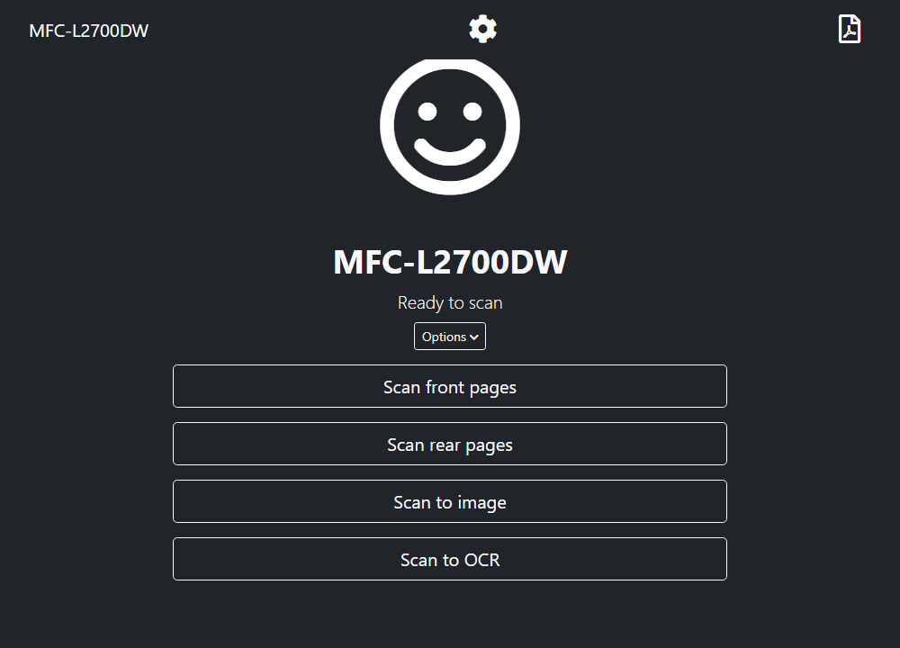

# Dockerized Brother Scanner

A scan server for network Brother scanners in a Docker container, so it also runs on a NAS such as a Synology DiskStation. The scanner's shortcut buttons, a web UI and a REST API start scans; the pages land as PDFs on a mounted volume, optionally with blank pages removed, OCR'd by a separate service, uploaded by FTPS and announced by Telegram. Duplex documents work on simplex ADFs: scan the front pages, turn the stack, scan the rear pages, and both sides are merged into one PDF.



## Quick start

```yaml
services:
  brother-scanner:
    image: ghcr.io/philippmundhenk/brotherscannerdocker:v2
    volumes:
      - /path/on/host:/scans
    ports:
      - 54925:54925/udp # mandatory, for scanner tools
      - 54921:54921 # mandatory, for scanner tools
      - 161:161/udp # mandatory, for scanner tools
      - 8080:8080 # web UI and API
    environment:
      - NAME=Scanner
      - MODEL=MFC-L2700DW
      - IPADDRESS=192.168.1.10 # the scanner
      - HOST_IPADDRESS=192.168.1.20 # this host, as the scanner reaches it
      - UID=1000 # owner of the scans on the volume
      - GID=1000
      - TZ=Europe/Berlin
      - WEBSERVER=true
      - PORT=8080
    restart: unless-stopped
```

The scanner then shows "Scanner" as a Scan-to-PC destination, and the web UI is at `http://<host>:8080`. The `v2` tag follows the newest 2.x release; `stable` is the newest release overall, `latest` the development build (see [image tags](doc/setup.md#image-tags)). Every further setting is optional; see [Setup](doc/setup.md) for the host-networking variant, permissions and a full example, and [Configuration](doc/configuration.md) for all options.

## Migrating from v1 to v2

- **Settings can live in a file and a settings page.** Everything that used to be an environment variable can also be a `KEY=VALUE` line in `/scans/.config/scanner.conf` on the volume, and with `ALLOW_GUI_SETTINGS=true` the web UI gets a settings page that edits that file. Nothing has to change: your compose file keeps working as it is.
- **The environment wins.** A value set in the compose file is shown read-only on the settings page with an `environment` badge. To manage it on the page instead, press "Copy environment values into the file" there, remove the entry from the compose file and restart.
- **Web UI and API are new.** The old `scan.php` and `active.php` still answer (deprecated); `list.php` and `download.php` are gone. The REST API with jobs, parameters and status is described in [Web UI and API](doc/web-ui.md).
- **OCR goes through a queue**, uploads never run while the scanner is busy, and an OCR result is validated before the original may be removed.

Details and the rest of the changes: [Migration guide](doc/migration.md).

## Documentation

- [Setup](doc/setup.md): bridged or host networking, permissions, scanner buttons, duplex, calibration, file sizes, full compose example
- [Configuration](doc/configuration.md): every option, the configuration file, the settings page, precedence, secrets
- [Web UI and API](doc/web-ui.md): the pages, thumbnails, the REST API, the API token, deprecated endpoints
- [OCR](doc/ocr.md): the OCR service, the queue, validation of results
- [Uploads and notifications](doc/notifications.md): FTPS upload, inotify over SSH, Telegram
- [Home Assistant](doc/home-assistant.md): the integration and the dashboard card, or the built-in `rest` platform
- [Customizing the scan scripts](doc/customizing.md)
- [Development and testing](doc/development.md)
- [Migration guide](doc/migration.md)

This is an independent project, not affiliated with Brother Industries, Ltd.; the Brother driver packages are downloaded from Brother at image build time.
