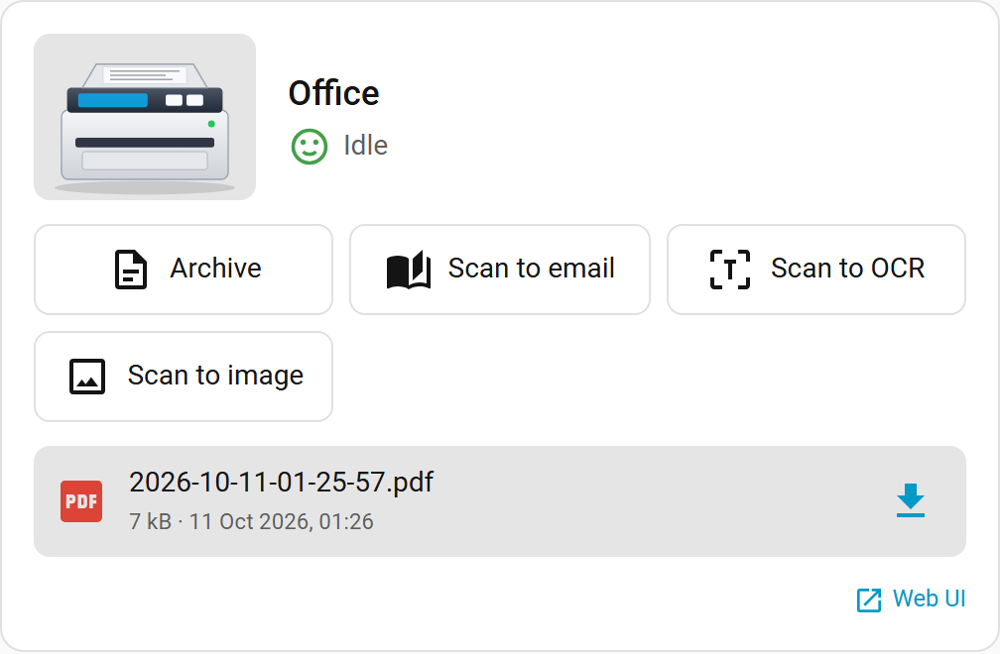

# Home Assistant

[Back to the README](../README.md)

There is a Home Assistant integration for this container, [ha-brother-scanner](https://github.com/PhilippMundhenk/ha-brother-scanner), with a dashboard card included: the integration serves the card and registers it as a dashboard resource, so there is nothing else to install. It installs through HACS (as a custom repository until it is in the default store; its README has the steps).

The integration creates one device per container with the scanner state, the last scan (downloadable through Home Assistant), the OCR queue, one button per scan action named like the buttons of the web UI, selects for resolution, mode and source from the device capabilities, services (`brother_scanner.scan`, `scan_rear`, `download_last_scan`) and events when a scan starts, finishes or fails. The container's API token stays on the Home Assistant server; downloads go through Home Assistant. It needs a container of version 2.0 or newer (`GET /api/actions`).



## Without the integration

Home Assistant's built-in `rest` platform covers the basics:

```yaml
rest:
  - resource: http://scanner.local:8080/api/scanner/status
    scan_interval: 5
    binary_sensor:
      - name: Scanner busy
        value_template: "{{ value_json.scan or value_json.waiting }}"
      - name: Scanner reachable
        value_template: "{{ value_json.reachable }}"
        device_class: connectivity

rest_command:
  scan_to_file:
    url: http://scanner.local:8080/api/scanner/scanto
    method: POST
    headers:
      X-API-Token: !secret scanner_token   # only with API_TOKEN
    payload: "target=file&resolution=300"
    content_type: application/x-www-form-urlencoded
```

A `rest` sensor from before version 2 that polls `/active.php` keeps working (deprecated); `/api/scanner/status` is the replacement.
